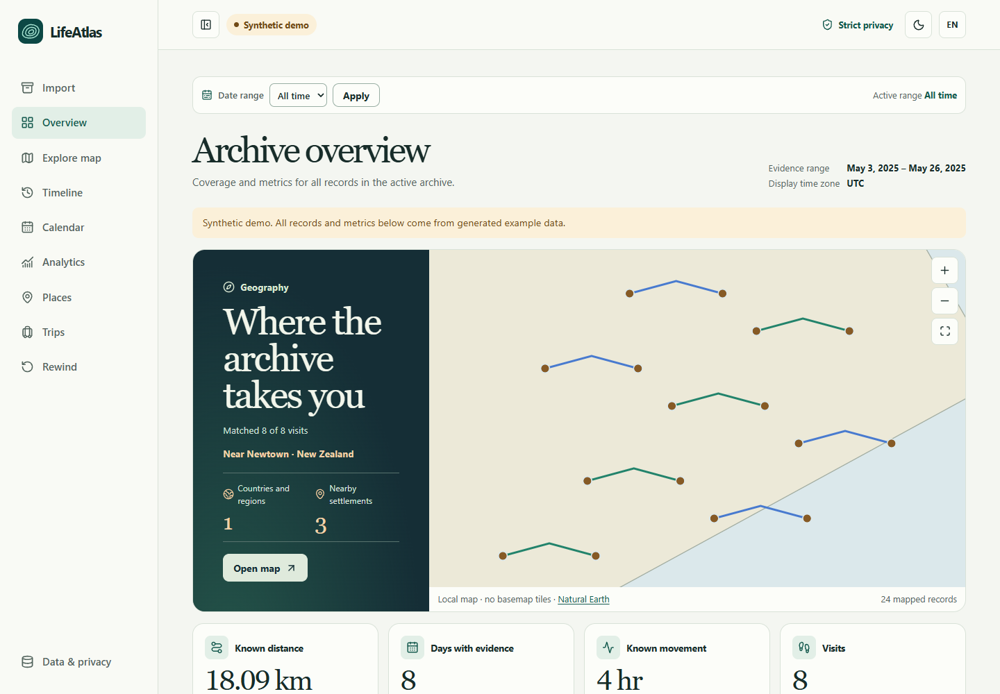
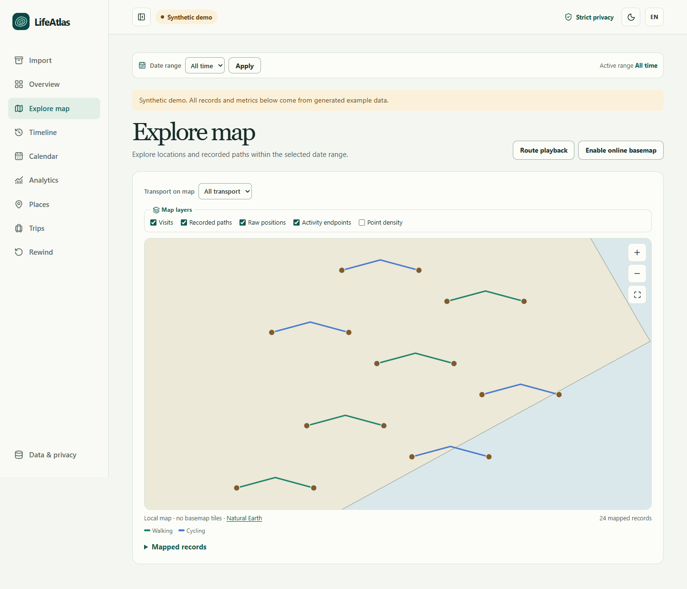

<p align="center">
  
</p>

<h1 align="center">LifeAtlas</h1>

<p align="center"><strong>Your life, mapped.</strong></p>

<p align="center">
  Explore your Google Maps Timeline in a private, browser-based atlas.
  Revisit a day, compare years, and turn your location history into a travel journal.
</p>

<p align="center">
  <a href="https://alikaanztrk.github.io/LifeAtlas/">Open LifeAtlas</a> ·
  <a href="#run-locally">Run locally</a> ·
  <a href="#türkçe">Türkçe</a> ·
  <a href="LICENSE">MIT License</a>
</p>



## Start with your timeline or try the demo

1. Open LifeAtlas in a current desktop Chrome. Choose **Open the demo** to explore fictional records, or select a Google Maps Timeline JSON file from your device.
2. Review the detected format, date range and import diagnostics. **For this tab only** keeps records in memory. **In this browser** saves the archive in your browser profile.
3. Set a date range and use **Calendar** to jump into a day or **Explore map** to inspect its positions and paths.

Need a JSON file? Follow Google’s export instructions for your device. [Android](https://support.google.com/maps/answer/6258979?co=GENIE.Platform%3DAndroid) · [iPhone or iPad](https://support.google.com/maps/answer/6258979?co=GENIE.Platform%3DiOS)

| View | What you can do |
| --- | --- |
| **Overview and Analytics** | Compare distance, coverage, movement time and visits. See the recorded and estimated parts of distance separately. |
| **Explore, Timeline and Calendar** | Follow the same date range through the map, day timeline and calendar. Play back timestamped route observations with gaps shown as gaps. |
| **Places and Trips** | Name and group visits, tag places, edit trips and review suggested overnight trips. Your labels and edits stay separate from the source records. |
| **Rewind** | Revisit a month or year, see where coverage is partial, and preview a portrait or square PNG. Select which summary fields to include. |

The archive map uses bundled country outlines and nearby settlement names. A label such as **Near İstanbul** describes an approximate area. LifeAtlas shows place names supplied in the export or entered in **Places**, and lets you name a visit when the export supplied coordinates alone. [Offline data sources](docs/THIRD_PARTY_NOTICES.md#offline-map-data)

<details>
<summary>More from the synthetic demo</summary>



[View the Turkish mobile Rewind screen](docs/images/demo-rewind-tr.png)

</details>

## Supported exports

| Timeline JSON format | Recognized structure |
| --- | --- |
| Android | Top-level `semanticSegments` array |
| iOS | Root array of segments with visits, activities or timeline paths |
| Legacy semantic | `timelineObjects` with place visits and activity segments |
| Legacy raw | `locations` with E7 coordinates and ISO or epoch-millisecond timestamps |

LifeAtlas accepts up to 12 files per import, **50 MiB per file** and **64 MiB combined**. Valid rows in a partial export can be imported after review. ZIP, GPX, KML and Android exports containing only `rawSignals` are outside the current importer.

<details>
<summary>How measurements and limits work</summary>

- A usable row can produce multiple records. Import diagnostics report skipped rows and duplicate records separately. The limits are 250,000 input rows, 250,000 normalized events, 400,000 geometry points and 2,000 points per path.
- The archive uses one display time zone, with an optional override and metric or imperial units. ISO timestamps need an explicit UTC offset. Supported UTC timestamps span 1900–2100.
- Reported activity distances take precedence. Eligible timestamped paths supply estimates. Conflicting activity distances are excluded, and overlapping durations are unioned. Missing measurements, recorded zero and raw-only signals retain their separate meanings.
- Period comparisons default to the same number of calendar days. Missing and zero baselines omit percentage change. Transport shares use the labelled known time or known distance denominator.
- The map samples large sets for display and groups points. The distance calculations use canonical geometry. Playback uses observed coordinates and omits the marker in gaps. If playback reaches its 32,000-observation limit, narrow the date range.
- Trips can be entered manually. Automatic suggestions require an explicitly tagged Home and a recorded overnight visit away from it. Suggestions become trips only after you save them. The edit history supports up to 1,024 operations per archive.

</details>

## Privacy and offline use

LifeAtlas reads and analyzes selected files on your device. It runs without an account, API key, server-side archive storage or telemetry. **Data & privacy** lets you delete the saved archive or clear local archive data and preferences. Saved archives use unencrypted IndexedDB. Anyone with access to the browser profile or its extensions may be able to inspect them.

Country and settlement lookup uses the bundled Natural Earth and GeoNames files, including offline. Coordinates are processed in a local worker.

- **Local map by default.** The optional OpenFreeMap basemap requires permission for the current tab. The provider receives tile coordinates, zoom, IP address and request timing. Route playback uses the local map. [OpenFreeMap](https://openfreemap.org/quick_start/) · [OpenStreetMap attribution](https://www.openstreetmap.org/copyright)
- **Install or open offline.** Open the production site, then wait for **Ready to open offline** under **Data & privacy → Offline access**. Install from the Chrome menu or keep opening the same URL. The service worker caches app files. To apply an available update, close all LifeAtlas tabs and windows and reopen. Closing a tab clears its session archive.
- **Review before sharing.** Rewind exports an image on your device. The image contains only the summary fields you enable. Coordinates, paths, place names and exact timestamps are excluded.

The browser may evict offline app files and saved archives. Clearing archive data in LifeAtlas preserves the original JSON and the cached app. Use Chrome’s site data settings to remove the cache as well.

## Run locally

Use Node.js 22.13+ on the 22.x line or Node.js 24+, and current desktop Chrome.

```sh
npm ci
npm run dev
```

Open [the development app](http://127.0.0.1:5173/LifeAtlas/). Build and preview the production app to test offline access.

```sh
npm run build
npm run preview
```

Open [the production preview](http://127.0.0.1:4173/LifeAtlas/). Windows PowerShell users can use `npm.cmd` if their execution policy blocks the npm wrapper.

## Contribute

LifeAtlas is a static React and TypeScript app. Vite builds the app, Web Workers parse and query archives, IndexedDB holds saved archives, and MapLibre and ECharts render the map and charts. Use the built-in demo or synthetic fixtures to reproduce issues.

Application code lives in [src/](src/), Vite and Playwright configuration in [config/](config/), browser tests in [e2e/](e2e/) and build utilities in [scripts/](scripts/).

```sh
npm run lint
npm run typecheck
npm run test
npm run build
npm run scan:artifacts
npm run test:e2e
```

Playwright uses installed Chrome on Windows when available. On other hosts, install Chromium with `npx playwright install chromium` or set `LIFEATLAS_CHROME_PATH`. Run `npm run fixture:generate -- 50` to create a deterministic stress input under `.local/`.

Report privacy and security issues privately. Use **Security → Report a vulnerability** when available and include a synthetic reproducer and the browser version. Keep personal exports and screenshots of real archives out of public reports.

[Third-party notices](docs/THIRD_PARTY_NOTICES.md) · [Pages workflow](.github/workflows/pages.yml)

## Türkçe

LifeAtlas, Google Maps Zaman Çizelgesi arşivinizi tarayıcıda incelemenizi sağlar. **Demoyu aç** ile sentetik kayıtları keşfedebilir veya kendi JSON dosyanızı seçebilirsiniz. **Yalnızca bu sekmede** seçeneği arşivi bellekte tutar. **Bu tarayıcıda** seçeneği kaydedilmiş arşivi yeniden açmanızı sağlar.

**Veri ve gizlilik → Çevrimdışı erişim** bölümünde **Çevrimdışı açılmaya hazır** durumundan sonra Chrome menüsünden uygulamayı yükleyebilirsiniz. Konum verilerinizi sorun bildirimlerine veya bu depoya eklemeyin. [LifeAtlas’ı aç](https://alikaanztrk.github.io/LifeAtlas/) · [Yerelde çalıştır](#run-locally)
